# Guide utilisateur : Météo temps réel des instances PostgreSQL

Ce guide s'adresse aux **exploitants et DBA** qui utilisent les écrans Grafana et gèrent le parc surveillé. Il ne traite ni l'installation (voir [scrutateur.md](scrutateur.md)) ni la conception (voir [architecture.md](architecture.md)). Le projet jumeau pour SAP ASE est [RT_Meteo_ASE](https://github.com/serentz/RT_Meteo_ASE) : mêmes écrans, mêmes indicateurs, mêmes seuils.

| Vous voulez... | Aller à |
|---|---|
| Savoir si mes instances vont bien | [1. Lire la synthèse](#1-lire-la-synthèse) |
| Comprendre pourquoi une instance est au nuage ou à l'orage | [2. Analyser une instance](#2-analyser-une-instance) |
| Ajouter, modifier, retirer une instance | [4. Gérer les instances](#4-gérer-les-instances) |
| Régler les seuils | [5. Régler les seuils](#5-régler-les-seuils) |
| Comprendre une lune ou un écran vide | [7. Quand rien ne va comme prévu](#7-quand-rien-ne-va-comme-prévu) |

## Le principe en 30 secondes

Toutes les minutes, un petit programme (le **scrutateur**, installé sur le bastion) interroge chaque instance PostgreSQL déclarée, **à distance**, avec **une seule** requête en lecture seule sur `pg_stat_activity` (et `pg_blocking_pids()`). Rien n'est installé sur les serveurs surveillés : ni agent, ni extension (pas de `pg_stat_statements`), aucun compteur cumulatif remis à zéro, et le **texte des requêtes n'est jamais lu** (seul son premier mot, `SELECT`, `UPDATE`..., est conservé). L'impact sur l'instance est minimal. Les résultats sont stockés dans PostgreSQL et affichés par Grafana. Chaque instance reçoit un état météo :

| Icône | État | Signification |
|---|---|---|
| Soleil | `soleil` | Tous les indicateurs sont sous leur seuil d'attention. |
| Nuage | `nuage` | Au moins un indicateur a dépassé le seuil d'attention (warning). |
| Orage | `orage` | Au moins un indicateur a dépassé le seuil d'alarme. |
| Lune endormie | `inconnu` | Le scrutateur n'a pas de mesure fiable : instance injoignable, relevé en erreur, ou dernier relevé trop ancien. |

L'état d'une instance est **le pire** de ses indicateurs. La lune n'est jamais remplacée par un soleil faute de mesure : « je ne sais pas » ne se déguise pas en « tout va bien ».

## 1. Lire la synthèse

Ouvrir Grafana (`http://<bastion>:3000`), tableau de bord **Météo des instances PostgreSQL**. Il se rafraîchit seul toutes les 30 secondes.

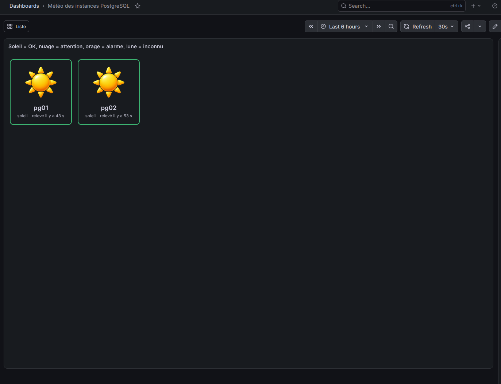

- **Une tuile par instance**, avec son icône, son nom et une phrase : `soleil - relevé il y a 22 s`.
- **Les plus mal en point d'abord** : orages, puis lunes, puis nuages, puis soleils. Avec 100 ou 200 instances, un problème ne se cache jamais sous la ligne de flottaison ; faire défiler pour voir les soleils.
- **La bordure** reprend la couleur de l'état (vert, orange, rouge).
- **Cliquer sur une tuile** ouvre le détail de l'instance.
- Le bouton **Liste** (en haut) bascule vers une vue tabulaire : une ligne par instance avec l'état, le statut du relevé (`ok` ou `erreur`), l'âge du relevé en secondes et le message d'erreur éventuel. Le bouton **Tuiles** ramène à la synthèse.

### Les phrases sous le nom

| Phrase | Sens |
|---|---|
| `soleil / nuage / orage - relevé il y a N s` | Dernier relevé réussi, il y a N secondes (normalement moins de 60 s). |
| `relevé en erreur il y a N s` | Le dernier relevé a échoué ; la ligne `erreur` en dessous donne la cause. |
| `dernier relevé trop ancien (N s)` | Plus de 180 s sans relevé : le scrutateur est arrêté ou en retard. |
| `pas encore relevé` | Instance déclarée, aucun relevé reçu pour l'instant. |

## 2. Analyser une instance

Cliquer sur la tuile (ou ouvrir **Détail d'une instance PostgreSQL** et choisir l'instance dans la liste déroulante en haut). Quatre tableaux, de haut en bas.

### 2.1 État de l'instance

Une ligne : état, statut du relevé, heure du dernier relevé, âge en secondes, erreur éventuelle. Si l'état est `inconnu`, la cause est ici.

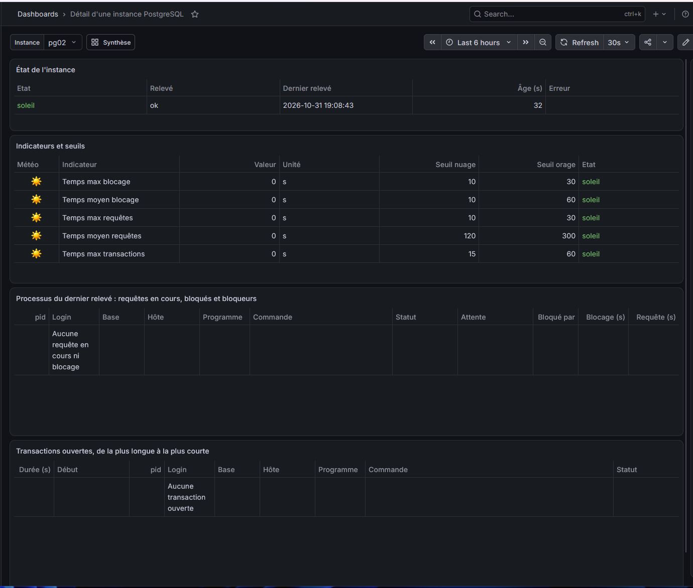

### 2.2 Indicateurs et seuils

Cinq indicateurs, tous en secondes, chacun avec son seuil nuage et son seuil orage :

| Indicateur | Ce qu'il mesure |
|---|---|
| **Temps max blocage** | Durée du plus long blocage en cours (une session attend un verrou tenu par une autre). **Approximation** : PostgreSQL n'indique pas depuis quand une session attend ; la valeur est la durée de l'instruction bloquée, donc une borne haute de l'attente réelle. |
| **Temps moyen blocage** | Durée moyenne des blocages en cours. |
| **Temps max requêtes** | Durée de la plus longue requête en cours d'exécution (bloquée ou non ; seules les sessions `active` comptent). |
| **Temps moyen requêtes** | Durée moyenne des requêtes en cours. |
| **Temps max transactions** | Âge de la plus ancienne transaction ouverte, y compris une session `idle in transaction`. |

Un relevé sans blocage ni requête en cours donne **0** et non un trou : 0 s'affiche au soleil. Une valeur vide signifie que la mesure n'a pas pu être faite (état inconnu).

Seuils par défaut (provisoires, en secondes) :

| Indicateur | Nuage à partir de | Orage à partir de |
|---|---|---|
| Blocage max | 30 | 120 |
| Blocage moyen | 10 | 60 |
| Requête max | 60 | 300 |
| Requête moyenne | 120 | 300 |
| Transaction max | 300 | 900 |

Règle : valeur **inférieure** au premier seuil = soleil ; **entre** les deux = nuage ; **à partir du second** = orage. Ils peuvent être adaptés globalement ou instance par instance ([section 5](#5-régler-les-seuils)).

### 2.3 Processus du dernier relevé

Les sessions intéressantes au moment du dernier relevé : requêtes en cours, transactions ouvertes, sessions bloquées et **bloqueurs** (même inactifs). Colonnes : `pid`, login, base, hôte, programme, commande (premier mot de la requête), statut (`active`, `idle in transaction`...), attente (`type:événement`, par exemple `Lock:transactionid` ou `Timeout:PgSleep`), bloqué par (pid du bloqueur), durée de blocage, durée de la requête. Les indicateurs sont calculés sur toutes les sessions retenues, mais seules 200 lignes sont conservées dans le détail (bloquées et plus longues d'abord). Tri : les plus bloqués, puis les requêtes les plus longues. Si rien n'est en cours, une ligne l'indique : « Aucune requête en cours ni blocage ».

### 2.4 Transactions ouvertes

De la plus longue à la plus courte : durée, heure de début (heure du serveur surveillé), `pid`, login, base, hôte, programme, commande, statut. Une transaction ouverte et inactive (`idle in transaction`) est la cause classique de blocages et empêche le nettoyage des lignes mortes par `autovacuum`.

> Le détail est une photo du **dernier relevé réussi** (au plus 60 s d'âge). Il ne montre pas l'historique : une requête terminée entre deux relevés n'apparaît pas.

## 3. Scénarios de diagnostic

Chaque scénario a été reproduit sur les VM de test (PostgreSQL 16) ; les images viennent de [captures.md](captures.md).

### Une requête dure trop longtemps

Tuile au nuage puis à l'orage ; dans le détail, *Temps max requêtes* a franchi 60 s puis 300 s. Le tableau des processus nomme la session (ici un `SELECT` en attente `Timeout:PgSleep`).

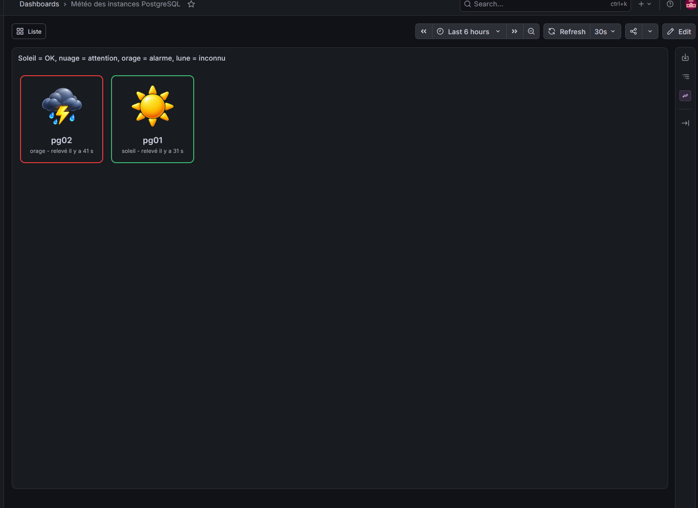
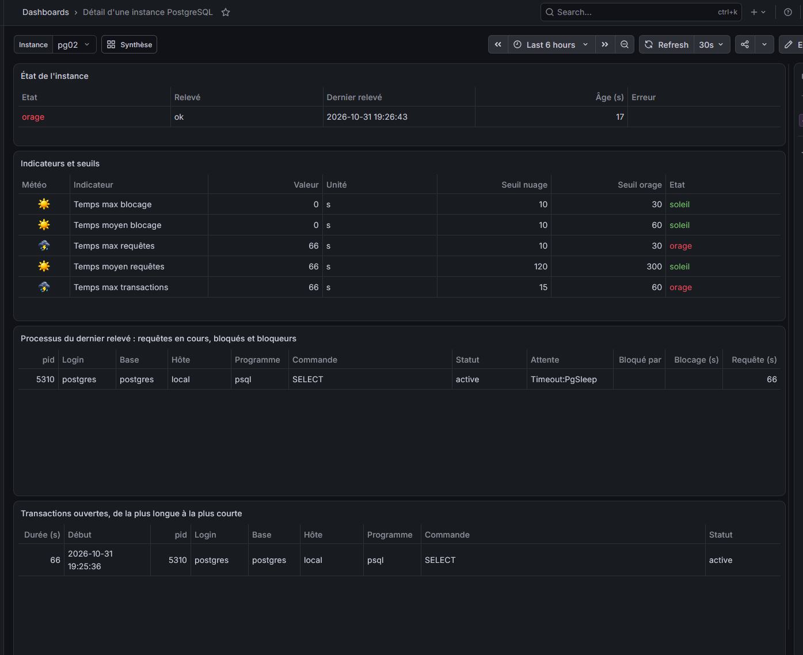

**Action** : identifier login, base, hôte et programme pour joindre l'utilisateur ; décider d'attendre, d'annuler la requête (`SELECT pg_cancel_backend(<pid>);`) ou de fermer la session (`SELECT pg_terminate_backend(<pid>);`), en superutilisateur sur l'instance concernée.

### Un blocage

*Temps max / moyen blocage* en hausse. Le tableau montre la session bloquée (ici un `UPDATE`, attente `Lock:transactionid`) et, dans la colonne « Bloqué par », le `pid` du **bloqueur**, souvent `idle in transaction` mais identifié.

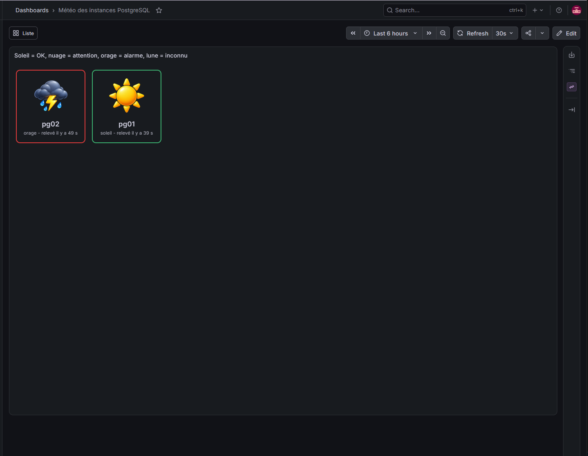
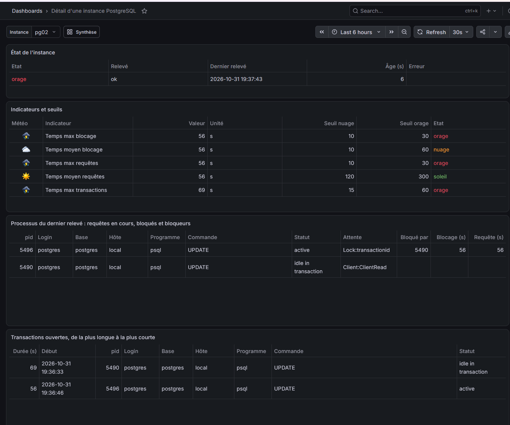

**Action** : regarder le bloqueur dans le tableau des transactions (une transaction ouverte et oubliée est la cause la plus fréquente), puis le faire terminer (`pg_terminate_backend`). Le blocage disparaît au relevé suivant.

### Une transaction oubliée

Aucune requête ni blocage, mais *Temps max transactions* grimpe : une session a ouvert une transaction (`BEGIN; UPDATE ...`) et n'a ni validé ni annulé.

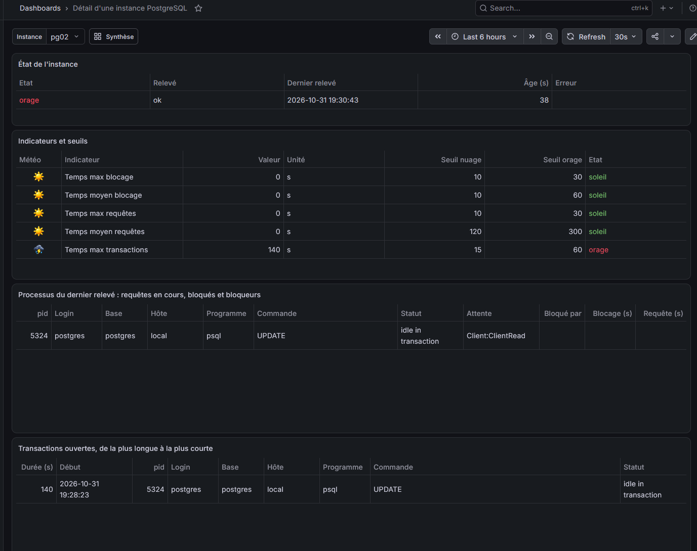

**Action** : le tableau donne le début, le login et l'hôte. Soleil tant que la durée reste sous 300 s, nuage ensuite, orage à 900 s (seuils par défaut). Après `ROLLBACK` ou `COMMIT`, tous les indicateurs reviennent à 0.

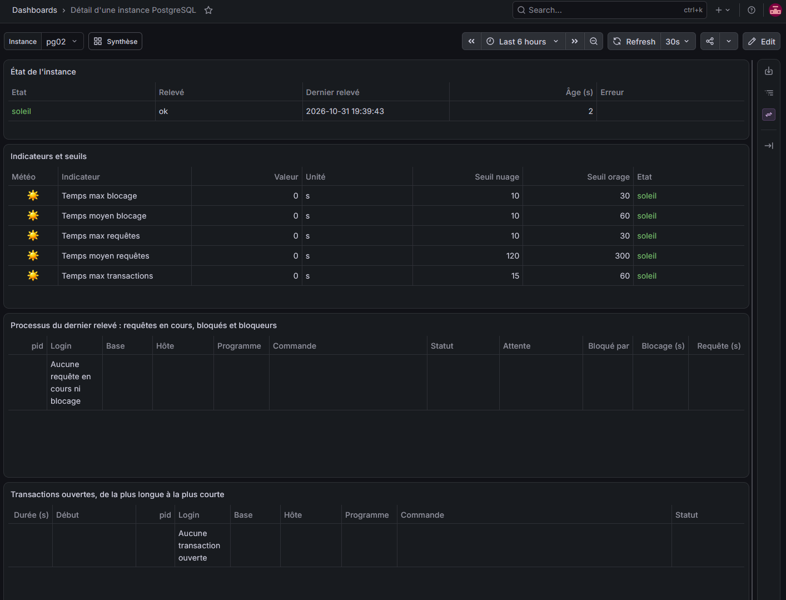

### L'instance est arrêtée ou injoignable

Tuile en lune, « relevé en erreur ». L'erreur (connexion refusée, délai dépassé, login refusé...) est visible sous le nom, et dans le détail les cinq indicateurs passent à `inconnu`.

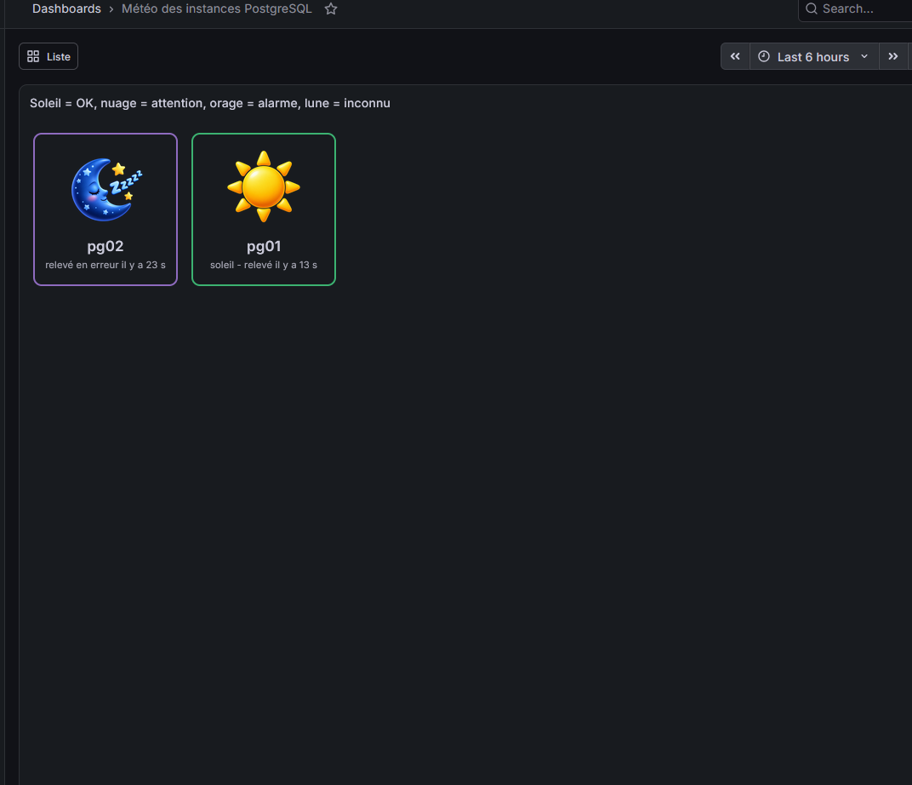
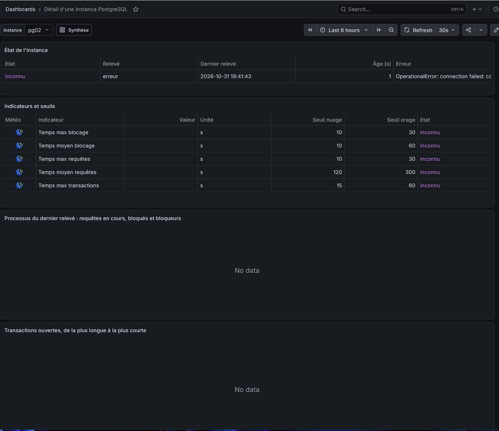

**Action** : voir [section 7](#7-quand-rien-ne-va-comme-prévu). Au redémarrage de l'instance, le soleil revient au relevé suivant, sans intervention.

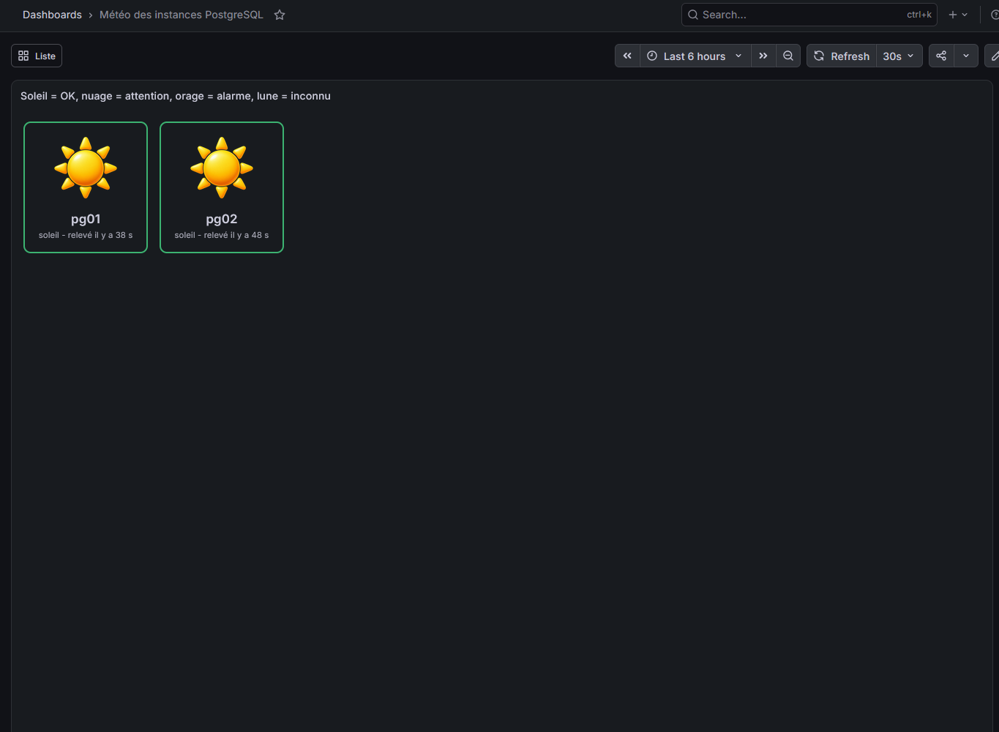

## 4. Gérer les instances

Le parc est la table `meteo.instance`. Le scrutateur la **relit à chaque cycle** : un ajout, une modification ou un retrait est pris en compte dans la minute, **sans redémarrage**.

Ces commandes se tapent sur **pg01**, dans la console PostgreSQL :

```bash
sudo -u postgres psql -d meteo
```

### Préparer l'instance à surveiller (une fois par instance)

Sur **chaque instance surveillée**, en superutilisateur (`sudo -u postgres psql`) :

```sql
CREATE ROLE scrutateur LOGIN PASSWORD 'MOT_DE_PASSE_CIBLE';
GRANT pg_monitor TO scrutateur;
```

- `pg_monitor` est **indispensable** : sans lui PostgreSQL masque l'état, la requête et le début de transaction des sessions des autres utilisateurs, et le tableau serait faussement vide. Le scrutateur le contrôle avant chaque relevé et signale une erreur claire (état `inconnu`) plutôt qu'un faux soleil.
- Ce login ne reçoit aucun autre droit : il ne lit aucune donnée applicative.

Puis autoriser le bastion dans `pg_hba.conf` de l'instance surveillée (adresse du bastion, ici `192.168.50.10`), et recharger :

```bash
echo "host all scrutateur 192.168.50.10/32 scram-sha-256" | sudo tee -a /etc/postgresql/16/main/pg_hba.conf
sudo systemctl reload postgresql
```

(`16` : version de PostgreSQL installée ; `listen_addresses` doit aussi écouter sur le réseau.) Procédure complète et vérification depuis le bastion : [scrutateur.md](scrutateur.md), sections 2.2 à 2.4.

### Ajouter

```sql
INSERT INTO meteo.instance (nom, login, password, host, port, base)
VALUES ('pg_prod1', 'scrutateur', 'MOT_DE_PASSE_CIBLE', 'srv-pg1.exemple.fr', 5432, 'postgres');
```

- `nom` : nom affiché, unique. Si `host` est vide, c'est aussi le nom de machine contacté.
- `host` : adresse ou nom résolu **par le bastion** ; `port` : 5432 par défaut ; `base` : base de connexion (`postgres` par défaut), sans effet sur le résultat puisque `pg_stat_activity` couvre toute l'instance.
- Une apostrophe dans le mot de passe se double (`''`).

### Modifier, désactiver, réactiver

```sql
UPDATE meteo.instance SET password = 'NOUVEAU' WHERE nom = 'pg_prod1';
UPDATE meteo.instance SET actif = false WHERE nom = 'pg_prod1';   -- sort de la surveillance et de l'affichage
UPDATE meteo.instance SET actif = true  WHERE nom = 'pg_prod1';
```

Désactiver conserve l'historique ; l'instance disparaît des écrans.

### Supprimer définitivement

```sql
DELETE FROM meteo.instance WHERE nom = 'pg_prod1';
```

Supprime aussi tout son historique (mesures, processus, transactions, seuils propres).

### Contrôler

```sql
SELECT nom, host, port, base, actif FROM meteo.instance ORDER BY nom;
SELECT * FROM meteo.etat_instance ORDER BY instance;
```

> Les mots de passe des instances sont stockés **en clair** dans cette table (choix du POC). Seul le rôle `scrutateur` les lit ; Grafana n'y a pas accès. N'accorder aucun autre droit sur la table et utiliser un login de supervision sans autre privilège que `pg_monitor`.

## 5. Régler les seuils

Les seuils sont dans `meteo.seuil` (secondes). Deux niveaux : une ligne **par défaut** (`instance_id` vide) pour tout le parc, et une ligne **spécifique** à une instance qui la remplace. Condition : `0 <= warning < alarme`.

Codes des indicateurs : `blocage_max`, `blocage_moyen`, `requete_max`, `requete_moyenne`, `transaction_max`.

**Voir les seuils actuels** :

```sql
SELECT COALESCE(i.nom, '(défaut)') AS instance, s.indicateur, s.warning, s.alarme
FROM meteo.seuil s LEFT JOIN meteo.instance i USING (instance_id)
ORDER BY 1, 2;
```

**Changer le défaut pour tout le parc** :

```sql
UPDATE meteo.seuil SET warning = 60, alarme = 240
WHERE instance_id IS NULL AND indicateur = 'requete_max';
```

**Un seuil différent pour une instance** (par exemple un entrepôt où les requêtes longues sont normales) :

```sql
INSERT INTO meteo.seuil (instance_id, indicateur, warning, alarme)
SELECT instance_id, 'requete_max', 600, 3600 FROM meteo.instance WHERE nom = 'pg_dwh'
ON CONFLICT (instance_id, indicateur) DO UPDATE SET warning = EXCLUDED.warning, alarme = EXCLUDED.alarme;
```

**Revenir au défaut pour cette instance** :

```sql
DELETE FROM meteo.seuil
WHERE indicateur = 'requete_max' AND instance_id = (SELECT instance_id FROM meteo.instance WHERE nom = 'pg_dwh');
```

La modification est visible au rafraîchissement suivant de Grafana (30 s), sans redémarrer quoi que ce soit. Les valeurs fournies sont **provisoires** : les ajuster après quelques jours d'observation de la charge réelle, pour qu'un nuage signifie vraiment « regarder » et un orage « agir ».

## 6. Exploitation courante

### Le scrutateur tourne-t-il ? (sur le bastion)

```bash
systemctl status scrutateur
journalctl -u scrutateur -n 30 --no-pager      # derniers messages
journalctl -u scrutateur -f                    # suivi en direct (Ctrl+C pour quitter le suivi, pas le service)
```

Après un changement de `/etc/scrutateur/scrutateur.env` : `sudo systemctl restart scrutateur`. Avec plusieurs scrutateurs en partition : `scrutateur@0`, `scrutateur@1`...

### Tester une instance sans rien écrire (sur le bastion)

```bash
sudo -u scrutateur bash -c 'set -a; . /etc/scrutateur/scrutateur.env; set +a; cd /opt/scrutateur/app && /opt/scrutateur/venv/bin/python -m scrutateur --tester pg_prod1'
```

Affiche en JSON les cinq indicateurs et les processus lus. Le nom doit être écrit exactement comme dans `meteo.instance` (majuscules comprises). Sans `--tester` mais avec `--une-fois -v`, un cycle complet est exécuté et écrit.

### Lire l'état en SQL (sur pg01)

```sql
SELECT * FROM meteo.etat_instance;                                   -- une ligne par instance
SELECT * FROM meteo.etat_indicateur WHERE instance = 'pg_prod1';   -- indicateurs, seuils, niveaux
```

### Conserver la taille de la base raisonnable

Chaque relevé garde son tableau de processus. La fonction `meteo.purger(jours)` supprime les mesures plus anciennes que le nombre de jours donné (30 par défaut) et renvoie le nombre de lignes supprimées :

```sql
SELECT meteo.purger(30);
```

> Cette purge n'est **pas planifiée** par le dépôt : la lancer à la main ou la planifier (cron, `pg_cron`) selon la durée de conservation voulue.

### Combien d'instances ?

Le scrutateur relève les instances en parallèle (16 à la fois par défaut) et étale les départs sur 20 s. Un seul scrutateur suffit largement pour quelques dizaines d'instances. Pour 100 à 200 instances, voir [scrutateur.md](scrutateur.md), section 5 (mesure de la durée d'un relevé, partition entre plusieurs scrutateurs).

## 7. Quand rien ne va comme prévu

Une **lune** ne signifie pas forcément un problème sur PostgreSQL : elle dit « pas de mesure fiable ». La cause est lue dans la ligne d'erreur de la tuile, ou dans `meteo.etat_instance`.

| Constat | Cause probable | Que faire |
|---|---|---|
| **Une** instance en lune, `relevé en erreur` | PostgreSQL arrêté, réseau coupé, port fermé, login ou mot de passe refusé | Lire le message d'erreur ; tester avec `--tester` (section 6) ; essayer `psql -h <hôte> -U scrutateur postgres` depuis le bastion. Mot de passe changé côté instance : `UPDATE` de la section 4. |
| `password authentication failed for user "scrutateur"` | Mauvais mot de passe dans `meteo.instance` | Corriger avec l'`UPDATE` de la section 4. |
| `no pg_hba.conf entry for host` | Le bastion n'est pas autorisé sur l'instance surveillée | Ajouter la ligne `host all scrutateur <IP du bastion>/32 scram-sha-256` puis `systemctl reload postgresql` (section 4). |
| `DroitsInsuffisants` : « doit etre membre de pg_monitor » | Le login de supervision n'a pas le rôle `pg_monitor` | `GRANT pg_monitor TO scrutateur;` sur l'instance surveillée (section 4). Tant que ce n'est pas fait, l'état reste `inconnu` : jamais de faux soleil. |
| Le tableau des processus est vide alors qu'il y a des sessions | Même cause : sans `pg_monitor`, PostgreSQL masque les sessions des autres utilisateurs | Vérifier l'appartenance à `pg_monitor`. |
| `Connection refused` / `connection failed` | Réseau, port, ou `listen_addresses` ne couvre pas le réseau | Joindre l'équipe réseau ou PostgreSQL ; contrôler `host` et `port`. |
| `canceling statement due to statement timeout` (journal du scrutateur) | Instance surchargée : le relevé dépasse 15 s | Augmenter `SCRUTATEUR_CIBLE_REQUETE_TIMEOUT_S` dans `/etc/scrutateur/scrutateur.env`, puis redémarrer le scrutateur. |
| Erreur SSL à la connexion | Le serveur n'a pas de TLS ou le refuse | Régler `SCRUTATEUR_CIBLE_SSLMODE` (`disable` si pas de TLS). |
| **Toutes** les instances en lune, `dernier relevé trop ancien` | Scrutateur arrêté, ou PostgreSQL injoignable depuis le bastion | `systemctl status scrutateur` et `journalctl -u scrutateur` sur le bastion. |
| **Une partie** des instances en lune, toutes au même âge | Un des scrutateurs en partition est arrêté | `systemctl status scrutateur@0 scrutateur@1`. |
| Tuiles absentes ou « No data » | Source de données Grafana en erreur | *Connections → Data sources → meteo → Save & test* ; voir [scrutateur.md](scrutateur.md), section 4.4. |
| Une instance n'apparaît pas | Non déclarée, ou `actif = false` | `SELECT nom, actif FROM meteo.instance;` |
| La valeur d'un indicateur est vide | Mesure indisponible sur ce relevé | Lire l'erreur du relevé ; l'état de l'instance est `inconnu` tant que ça dure. |
| Soleil alors qu'un utilisateur se plaint d'une lenteur | Le problème est plus court que 60 s ou n'est pas un blocage / une requête / une transaction longue | Cette météo ne voit que ce qui dure au moins un relevé, et seulement ces cinq indicateurs ; elle ne remplace pas un outil d'analyse fine. |

Autres messages d'erreur et leurs pistes : tableau « Dépannage » de [scrutateur.md](scrutateur.md).

## 8. Ce que cette météo ne fait pas

- Pas de **texte de requête** : volontairement, il peut contenir des données ; seul le premier mot (`SELECT`, `UPDATE`...) est conservé. Pour analyser une requête, utiliser les outils habituels de l'instance (`pg_stat_statements`, journaux).
- Pas d'extension ni de vue cumulative (`pg_stat_statements`, `pg_stat_database`...) : rien n'est remis à zéro et les outils déjà en place ne sont pas perturbés.
- Durée de **blocage approximative** (voir section 2.2).
- Pas d'**historique** dans les écrans : seul le dernier relevé est affiché, même si les mesures sont conservées dans PostgreSQL.
- Pas d'**alertes** (mail, SMS) : la synthèse est à regarder, ou à brancher sur l'outil d'alerte de l'équipe à partir de `meteo.etat_instance`.
- Seuils **provisoires** : à valider avec les équipes PostgreSQL avant tout usage opérationnel.

## 9. Glossaire

| Terme | Sens |
|---|---|
| **Scrutateur** | Programme Python du bastion qui relève les instances chaque minute. |
| **Relevé** | Une interrogation d'une instance (deux requêtes en lecture seule). |
| **Instance** | Un serveur PostgreSQL déclaré dans `meteo.instance`. |
| **pid** | Identifiant du processus serveur d'une session PostgreSQL. |
| **pg_monitor** | Rôle prédéfini de PostgreSQL qui permet de voir l'activité de toutes les sessions ; requis pour le login de supervision. |
| **Bloqueur** | Processus qui détient un verrou attendu par un autre ; souvent inactif. |
| **Transaction ouverte** | Transaction commencée et ni validée ni annulée. |
| **Seuil nuage / orage** | Valeurs à partir desquelles l'état passe à `nuage` (warning) puis `orage` (alarme). |
| **Péremption** | Au-delà de 180 s sans relevé, l'état devient `inconnu`. |
